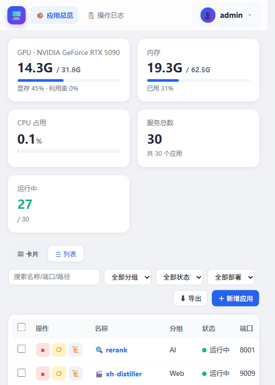

<p align="center">
  
  
  
  
</p>

<h1 align="center">🖥️ OpsBoard</h1>

<p align="center">面向自建 AI 服务器的轻量应用管理面板<br/>
<strong>实时资源监控 · 一键启停 · 部署文档 · 开机自启 · 手机端适配</strong></p>

<p align="center">
  <a href="#功能特性">功能特性</a> ·
  <a href="#快速开始">快速开始</a> ·
  <a href="#架构">架构</a> ·
  <a href="#截图">截图</a> ·
  <a href="#文档">文档</a> ·
  <a href="#许可">许可</a>
</p>

---

## 为什么需要 OpsBoard？

如果你在本地/自建服务器上跑着一堆 AI 服务——`vLLM` 推理、`whisper` 语音转写、`embedding`、`rerank`、`ComfyUI`、`WeKnora` 知识库、`Prometheus` 监控……你会发现：

- 每个服务一个端口、一个部署方式（`venv` / `docker` / `native`）、一份启动命令，**很难管**
- 想启停 / 看状态 / 看日志，要 SSH 上去敲一堆命令
- 显存 / 内存到底谁占了多少，没有统一视图
- 每个服务的部署文档散落在各处

**OpsBoard 就是干这个的**：把服务器上所有应用收进一个漂亮的可视化面板，实时看资源占用、一键启停、翻部署文档、管开机自启。纯本地、零依赖侵入、可二开。

---

## ✨ 功能特性

| 类别 | 能力 |
|---|---|
| 🔐 **登录鉴权** | JWT + bcrypt，修改密码，手机端自适应 |
| 📊 **实时监控** | GPU 显存/利用率、CPU 占用、内存占用 + 趋势图 |
| 🧩 **应用总览** | 卡片/列表双视图、分组/状态/部署方式筛选、关键字查询排序 |
| ▶️ **一键启停** | 启停/重启 systemd 服务与 docker 容器 |
| ⚡ **开机自启** | 每个应用独立自启开关 |
| 📁 **部署文档** | 每应用上传多个文档到 MinIO，面板内代理查看/下载 |
| 📜 **实时日志** | SSE 流式输出服务日志，大弹窗查看 |
| 🗃️ **应用管理** | 增删改应用（名称/端口/路径/账号密码） |
| 📤 **数据导出** | 一键导出全部应用信息 CSV |
| 📋 **操作日志** | 记录登录、启停、增删改操作 |
| 🚀 **轻量** | 原生前端无框架、SQLite 单库、依赖极少 |

---

## 🚀 快速开始

### 环境要求

| 组件 | 说明 |
|---|---|
| Python | 3.10+（服务器需能调 systemctl / docker / nvidia-smi） |
| 权限 | `sudo` 白名单或免密（启停服务用） |
| MinIO | 可选，部署文档功能需要（S3 兼容） |

### 安装

```bash
git clone <your-repo-url>
cd app-panel

# 1. 创建虚拟环境
python3 -m venv venv && source venv/bin/activate

# 2. 安装依赖
pip install -r backend/requirements.txt

# 3. 配置环境变量（复制示例并填写）
cp .env.example .env
# 至少设置 APP_PANEL_SECRET；如用文档功能再设 APP_PANEL_MINIO_*

# 4. 启动
cd backend
uvicorn app.main:app --host 0.0.0.0 --port 8085
```

### 一键部署（服务器，可选）

```bash
# 参考 deploy/deploy.sh，支持环境变量覆盖路径/端口
PORT=1234 ./deploy/deploy.sh
```

> 部署脚本幂等可重跑，保留 `data` 目录与 SQLite 数据。systemd 方式见 `deploy/app-panel.service`。

### 默认账号

- 首次初始化：`admin / admin123`
- **生产环境务必通过 `APP_PANEL_ADMIN_USER` / `APP_PANEL_ADMIN_PASSWORD` 指定并尽快修改**
- 登录后可在右上角菜单修改密码

---

## 🏗️ 架构

```mermaid
graph TD
    subgraph Browser[浏览器 PC / 手机]
        UI[原生 HTML/JS/CSS 前端]
    end

    subgraph Server[服务器]
        API[FastAPI 后端]
        DB[(SQLite<br/>元数据/用户/操作日志)]
        MINIO[(MinIO<br/>部署文档对象)]

        subgraph Collect[状态采集]
            SYS[systemctl / docker CLI]
            GPU[nvidia-smi]
            CPU[/proc + ps]
        end

        API --> DB
        API --> MINIO
        API --> SYS
        API --> GPU
        API --> CPU
    end

    UI -- "REST / SSE" --> API
```

### 目录结构

```
app-panel/
├── backend/
│   ├── app/
│   │   ├── main.py          # FastAPI 入口
│   │   ├── auth.py          # 登录鉴权 / JWT / 改密
│   │   ├── apps.py          # 应用 CRUD
│   │   ├── system.py        # 状态采集 / 启停 / 自启 / 日志
│   │   ├── overview.py      # 资源统计
│   │   ├── trend.py         # 资源趋势
│   │   ├── docs.py          # 部署文档（MinIO 上传/代理下载）
│   │   ├── logs.py          # 实时日志（SSE）
│   │   ├── db.py            # SQLite 初始化 / 迁移
│   │   └── config.py        # 配置（环境变量）
│   ├── static/index.html    # 前端（单页）
│   ├── requirements.txt
│   └── test_api.py          # API 冒烟测试
├── deploy/                  # 服务器一键部署（systemd/sudoers/脚本）
├── .env.example             # 环境变量示例
├── LICENSE
└── CHANGELOG.md
```

---

## 📸 截图

| 应用总览（实时资源监控 + 列表） | 应用总览（卡片视图） |
|---|---|
|  |  |

---

## 🔒 安全设计

- **凭据不写死代码**：MinIO、JWT 密钥、管理员密码全部走环境变量注入（`systemd Environment=` 或 `.env`）
- **部署文档代理下载**：文档查看经面板鉴权取流，不暴露 MinIO 私密接口/登录页
- **最小权限**：sudoers 白名单仅放行 `systemctl` 等必要命令（见 `deploy/sudoers-app-panel`）
- **SQLite 单库**：默认管理员只在首次初始化写入，之后密码加密存储

---

## 📚 文档

- [Changelog](CHANGELOG.md)
- [部署说明](deploy/README.md)
- API 文档：启动后访问 `http://<host>:<port>/docs`（FastAPI 自动生成）

---

## 🤝 贡献

欢迎提交 Issue 和 PR。请遵循：

1. Fork 本仓库
2. 新建分支 `feature/xxx` 或 `fix/xxx`
3. 提交前跑 `python backend/test_api.py` 保证冒烟通过
4. 提交 PR

---

## ⭐ 支持

如果这个项目对你有帮助，欢迎点个 Star ⭐，或提出你的需求——你的场景会直接影响下一个版本的功能方向。

---

## 📄 许可

[MIT](LICENSE) © 2026 15143221112

---

*OpsBoard 面向「自建 AI 服务器」场景，轻量、本地、可二开。有问题欢迎开 Issue。*
